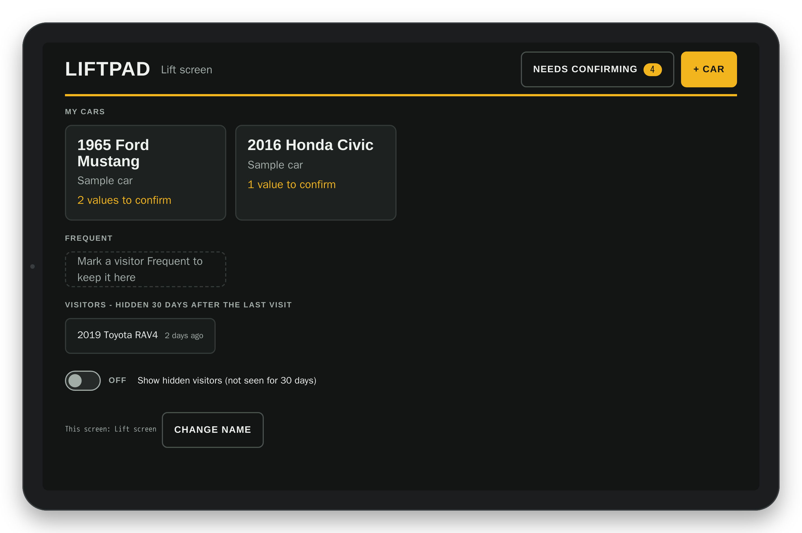
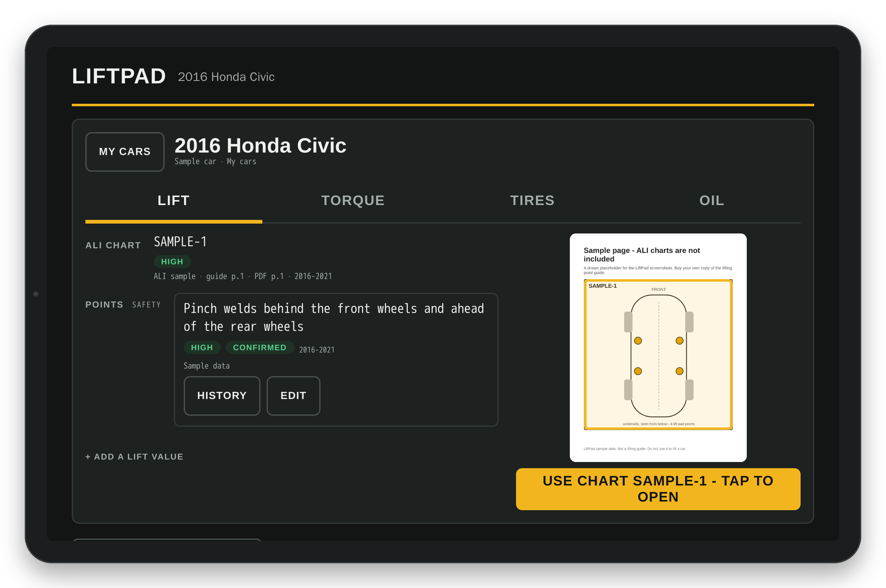
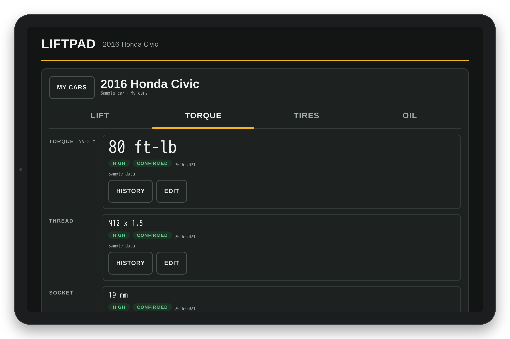
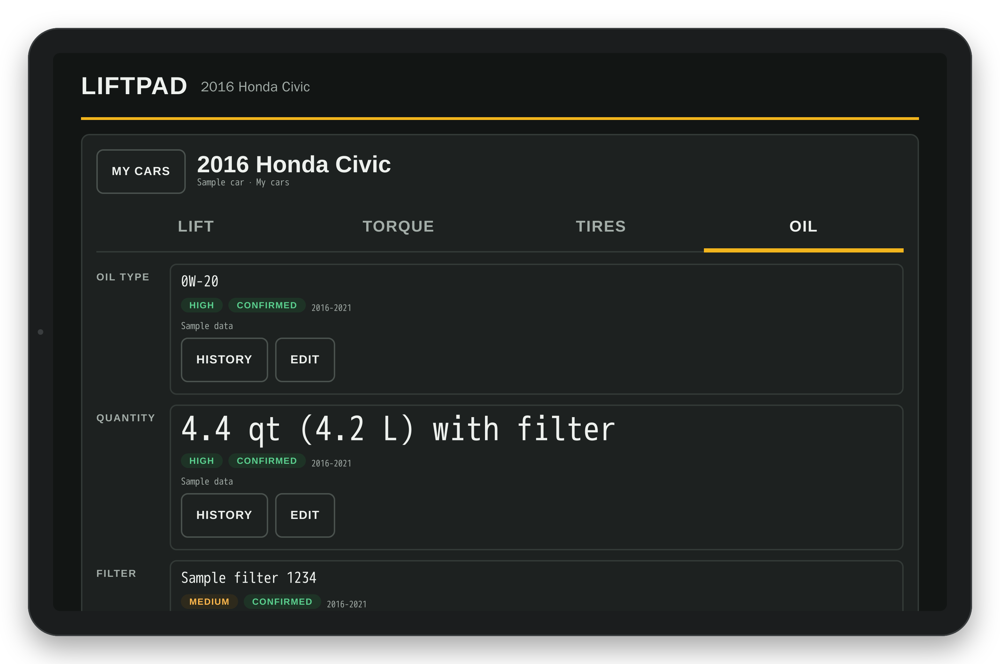
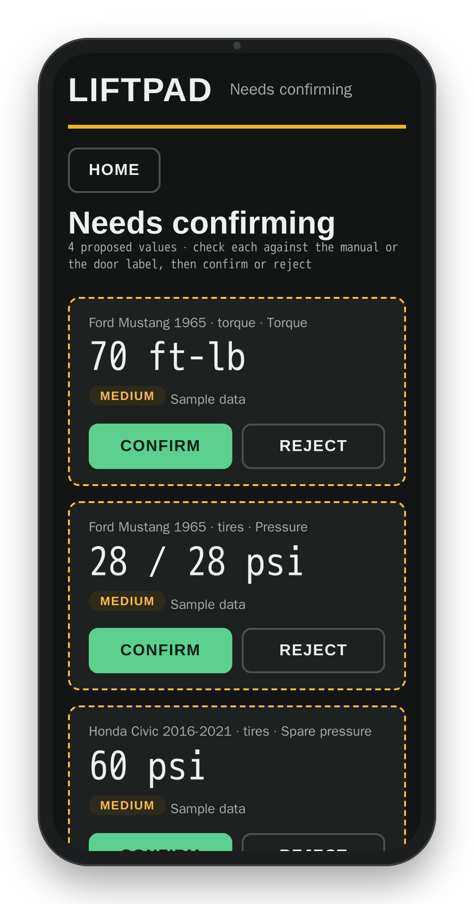

# LiftPad

LiftPad is a small web app for a home garage with a 2-post lift. A touch screen next to the lift shows the lift points, wheel torque and tire pressure for each car. The same app works on a phone or a laptop.

It runs on Cloudflare: one Worker serves the app and a small API, and one D1 database holds the data. Cloudflare Access puts a login in front of it.

## Screenshots

| | |
|---|---|
|  |  |
| Home: your cars, and what needs attention on each. | Lift: the chart, the lift points and the guide page with the chart outlined. |
|  |  |
| Torque: the value in large numbers, its confidence and its source. | Oil: oil type, quantity in qt and L, filter. |
|  | |
| Needs confirming (phone): confirm or reject proposed values. | |

Screenshots use sample data. The ALI lifting-point guide is not included in this repo.

Each screen is described in [docs/SCREENS.md](docs/SCREENS.md).

## What it does

- A list of your cars ([screenshot](docs/screenshots/tablet-home.png)). Each car has four tabs: Lift, Torque, Tires, Oil.
- Lift: the chart and page of your own lift guide, with the chart outlined ([screenshot](docs/screenshots/tablet-lift.png)).
- Torque: wheel torque in large numbers, with thread and socket ([screenshot](docs/screenshots/tablet-torque.png)).
- Oil: oil type, quantity and filter ([screenshot](docs/screenshots/tablet-oil.png)).
- Each value has a confidence (High, Medium, Low), a source and a note. A new value is proposed until you confirm it ([screenshot](docs/screenshots/phone-confirm.png)).
- Add a car by year, make and model, or decode a VIN.
- Make and model lists come from NHTSA vPIC (1981 and later) and from a classics list for older cars.
- Works offline with the last saved data.

## Hardware - recommended starting point

LiftPad is a web app: any modern browser works (phone, laptop, desktop). None of this hardware is required. This is the setup it was built and tested on, and a good starting point for a screen at the lift.

| Part | Model | Notes |
|---|---|---|
| Tablet | Lenovo Idea Tab 11, part **ZAFR0923US** (4 GB / 128 GB, Wi-Fi) | 11 in 2560x1600 IPS, 500 nits, 90 Hz; MediaTek Dimensity 6300; Android 15, updates to 2029 |
| Kiosk app | Fully Kiosk Browser PLUS | one-time license; landscape lock, screen always on, auto-start |
| Mount | VasSmtCPH magnetic tablet holder, model **MTSM-M-001** | 3.5 in rubber-coated base, 12 neodymium magnets, rated 66 lb pull; 360 deg ball head; holds 4.7-12.9 in devices |

**Suggested tablet spec for a lift screen** (any brand that meets it works):

- Screen 10-11 in, landscape, at least 1280x800 CSS pixels (the lift-screen layout is built and tested at 1280x800); 1920x1200 or better recommended; 400+ nits for a garage.
- Android 10 or later with a current Chrome / Android System WebView (Fully Kiosk uses it).
- Wi-Fi 5 GHz (802.11ac) or better.
- Battery charge limit (about 60-80%) if available, because it stays plugged in; otherwise a timer plug.
- Camera optional on the tablet (door-jamb and VIN photos are taken on the phone).
- Mount on a steel surface (the lift post), at eye level, clear of the carriage, arms and safety locks.

## Data sources

- **NHTSA vPIC** (public US government API) for makes, models and VIN decode. The Worker calls it at run time.
- **Classics list** (older makes such as Studebaker, AMC, Nash, Hudson): `tools/build_classics.py` builds it from Wikidata model names and Wikipedia infobox production years. Wikidata is rate-limited, so the build is slow. Check the result by hand.
- **Lift-point charts: NOT included.** The app can show which chart and page of the ALI / MOTOR *Lifting Point Guide* applies to a car. That guide is copyrighted. Buy your own copy, and type your own index into `private-data/ali-index.csv` (columns: `make,model,year_from,year_to,chart,guide_page,pdf_page,status,note`). Without it, the lift screen shows only the values you enter.

## Deploy your own

You need: a Cloudflare account with a domain, Docker, Python 3, and git.

1. Make a Cloudflare API token with these permissions: Account - D1 Edit, Workers Scripts Edit, Access: Apps and Policies Edit, Access: Service Tokens Edit; Zone - Workers Routes Edit, DNS Edit (for your domain).
2. Make a folder for secrets outside this repo, for example `~/.config/liftpad/`, and a file `cf.env` in it:

   ```
   CLOUDFLARE_API_TOKEN=<your token>
   CLOUDFLARE_ACCOUNT_ID=<your account id>
   ```

3. Make a folder `private-data/` (it is in `.gitignore`) with a file `deploy.env`:

   ```
   LP_HOSTNAME=lift.example.com
   LP_ACCESS_EMAIL=you@example.com
   LP_ACCESS_TEAM=yourteam.cloudflareaccess.com
   ```

   `LP_ACCESS_TEAM` is your Zero Trust team domain (Zero Trust dashboard, Settings). The Worker uses it to check the Access login proof (JWT) on the research-queue routes.

4. Optional: put your own data in `private-data/` and build a private seed. `my-cars.csv` has one row per value (`year,make,model,trim,tab,field,value,confidence,source,note,warn`; `tab` is lift, torque or tires).

   ```
   python3 tools/build_classics.py private-data/classics.csv
   python3 tools/make_seed.py private-data
   ```

   Without a private seed, the deploy loads `db/seed-public.sql`: the makes list and 2 example cars.

5. Deploy:

   ```
   docker run --rm -v "$PWD":/app -v ~/.config/liftpad:/cfg -v "$PWD/private-data":/private node:22-alpine sh /app/tools/deploy.sh
   ```

   The deploy creates the Access app, a login policy for your email, a service token for the self-test, the D1 database and the Worker. It edits `wrangler.toml` in place, so run it from a copy, not from your git checkout. It loads the database only when the database is empty. `-e RESEED=1` wipes the database and loads it again - this deletes the cars you added.

6. Self-test (the deploy saved the service token in `svc.env`):

   ```
   docker run --rm --env-file ~/.config/liftpad/svc.env -v "$PWD":/app -w /app node:22-alpine node test/selftest.js https://lift.example.com
   ```

## Contributions

This repository is an export from a private repository, one commit per release. Pull requests are not merged here, because the next export would overwrite them. Send patches by email to the address on the GitHub profile of rcsracing93. Contributors are named in the release notes.

## Licence

MIT. See `LICENSE`.
