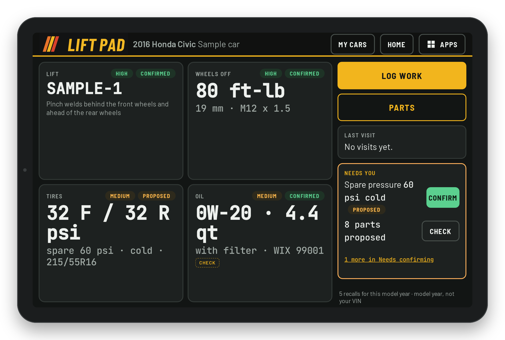
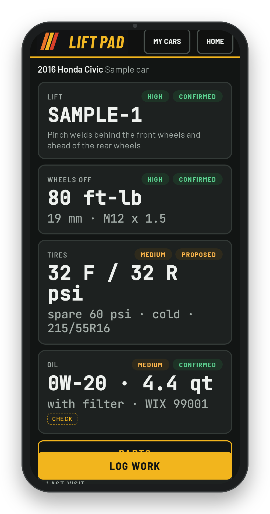
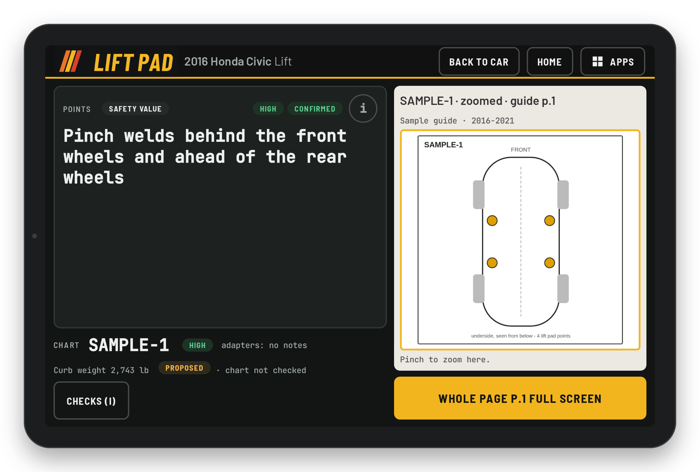
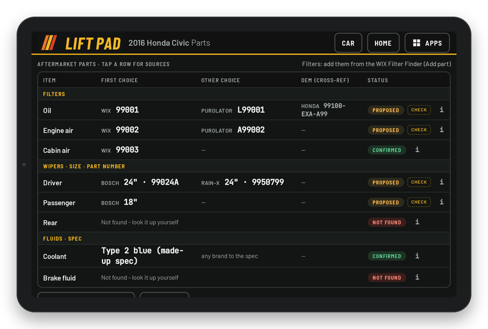
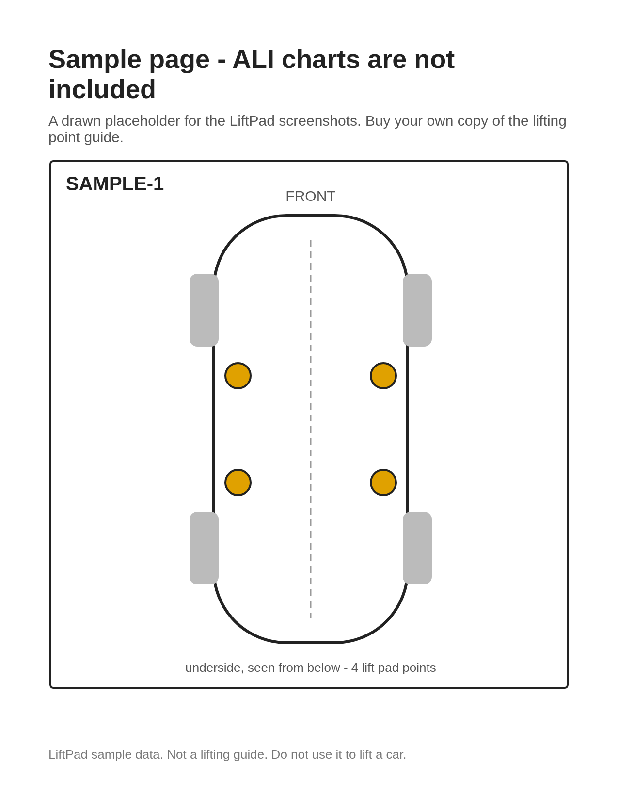

# LiftPad screens

One section per screen: what it is for, who uses it, and the main actions. The screenshots use sample data. The ALI lifting-point guide is not included in this repo: the Lift screenshot shows a drawn sample page instead.

LiftPad runs in any modern browser. It is built for three kinds of screen:

- **Lift screen**: a tablet in landscape on the lift (1280x800 CSS pixels, 64 px touch targets).
- **Phone**: in your hand next to the car (48 px touch targets). Door-jamb and VIN photos are taken here.
- **Mac** (or any laptop): for typing values and drawing chart outlines with a mouse or trackpad.

## The car

What it is for: everything about the car on the lift, one tile per topic.
Who uses it: lift screen, phone, Mac.
Main actions:

- Tap a tile to open it: **Lift** opens its own screen; the others (wheel torque, tires, oil) open a drawer over the car. Each tile shows the state of its values (confirmed, proposed, missing).
- A warning for the car shows at the top. An amber line is a standing step (a **caution**); a red line is a **block**, an open problem such as "do not lift yet".
- **Log work** records a visit. **Parts** opens the Parts screen. **Last visit** opens the service history.
- Values that wait for a decision are listed on the car with a **Check** or **Confirm** button.

The same screen on a phone: the tiles stack in one column.

## Lift

What it is for: where to put the lift pads.
Who uses it: lift screen, mainly.
Main actions:

- Read the chart for this car and the lift points. A warning shows at the top, every time, in an amber box that starts with "Caution" (a standing step, for example "keep pads off the battery pack"), or in a red box that starts with "Do not lift yet" (a block, an open problem). You set the level of each value (None, Caution or Block) when you add or edit it.
- The page of your own copy of the lift guide shows on the right, with the chart outlined, and **Use chart ...** in large text.
- Tap the page to open it full screen: pinch to zoom, drag, double-tap, Fit page. On a Mac, **Outline this chart** draws the box once for every car on that chart.
- Without a guide loaded the screen says "No lift data loaded".

## Parts

What it is for: the wipers, filters and fluids for this car.
Who uses it: lift screen, phone, Mac.
Main actions:

- Each row is one item (oil filter, engine and cabin air filter, wipers, coolant, brake fluid) with its part number or spec, a confidence word (High, Medium, Low) and its status. A new value is **proposed** until you confirm it.
- Tap a row to see its sources and its history, and to **Confirm**, **Reject** or edit it.
- **Add part** is where you type a filter in yourself; a part you type in is confirmed. The optional research helper looks up wipers and fluids only, never filters.
- Check a proposed part against the car before you confirm it.

## Other screens (no screenshot)

- **Home**: the list of cars (mine, frequent, visitors). Tap a car. **Needs confirming** (with its count) lists proposed values, each with Confirm and Reject. **+ Car** adds a car by make, year and model, or by VIN. Visitors are hidden 30 days after the last visit; mark one Frequent to keep it.
- **Wheel torque drawer**: torque in large numbers with its thread and socket. With no value yet, the make's typical value shows, marked Low and "not confirmed". **Look it up yourself** lists sites to check; LiftPad never reads them for you.
- **Tires drawer**: size, pressure and spare pressure, and **Door-jamb photo** (phone): take a photo of the label, then type what it says. The photo stays in your private storage.
- **Oil drawer**: oil type, quantity in both units and the filter. A battery-electric car shows "No engine oil (EV)".
- **Service log and history**: **Log work** records what was done, when and at what mileage.

## Sample page

The Lift screenshot uses this drawn page, not a page of the lift guide. It is not a lifting guide.

## Re-making the screenshots

The screenshots come from a local Worker with sample data, in drawn device frames (no brand). `docs/screenshots/MANIFEST.txt` lists each file with its sha256 (`sha256sum -c MANIFEST.txt` in that folder).
